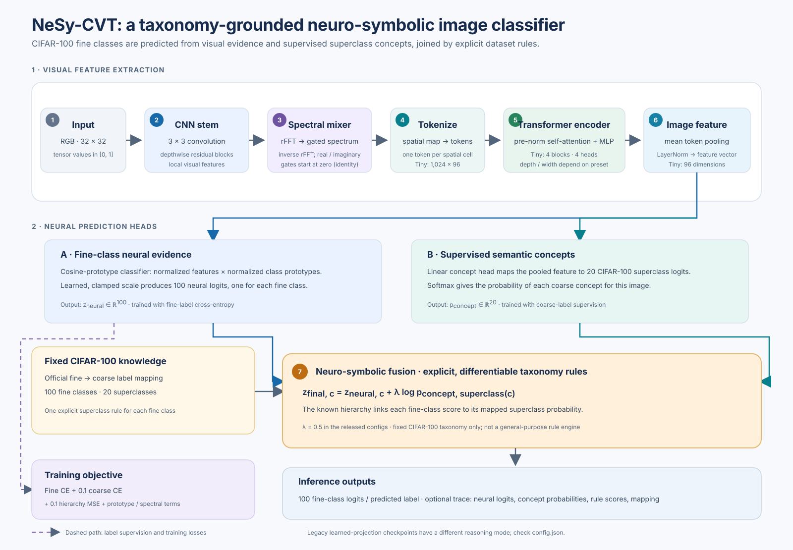
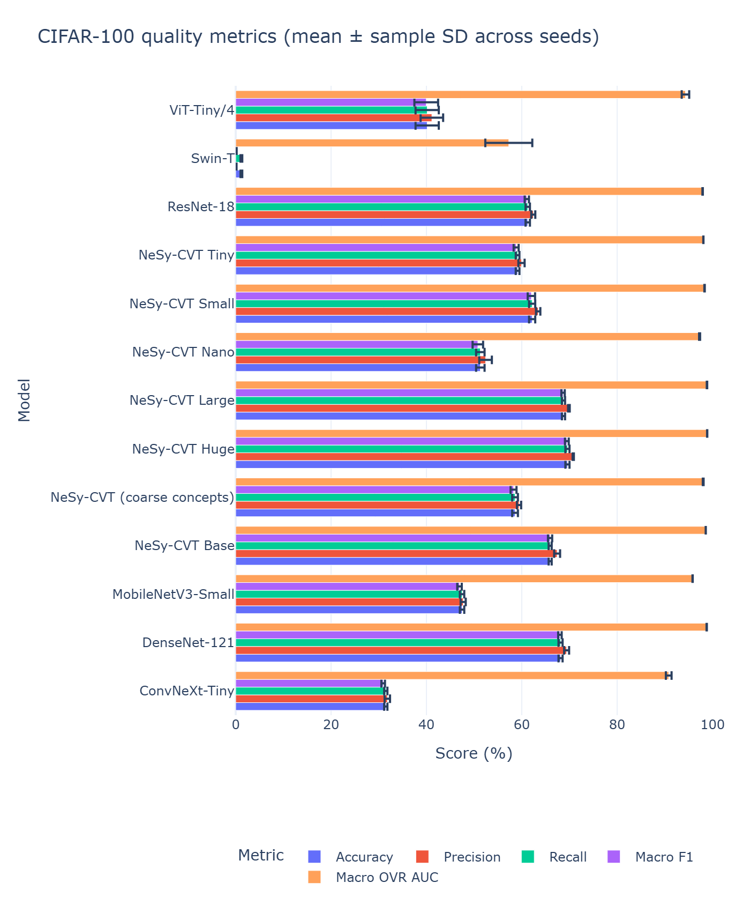
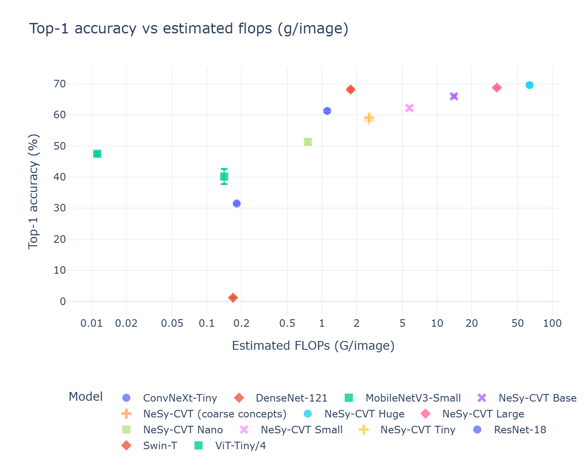
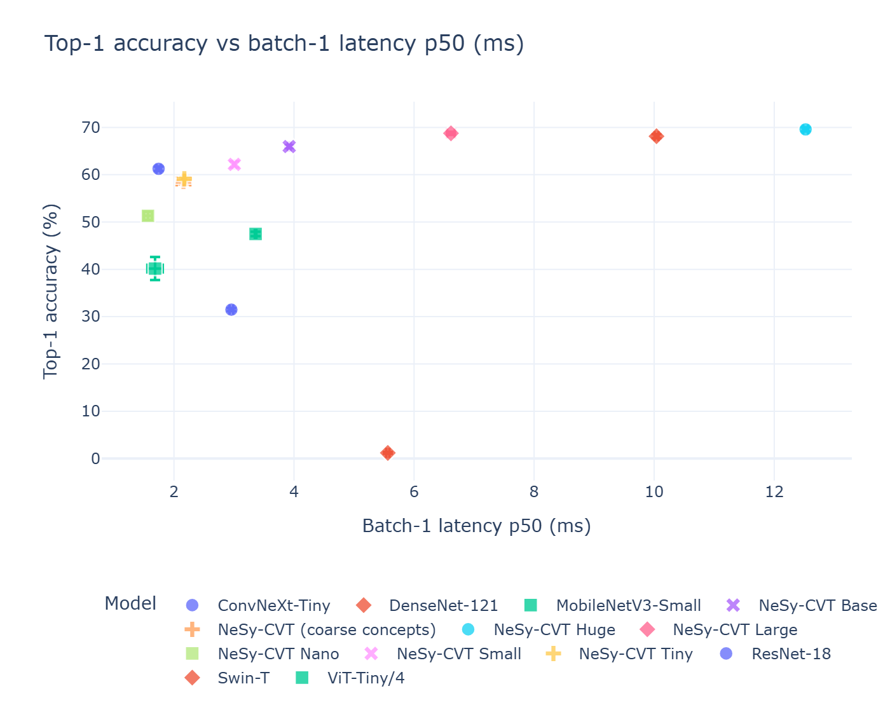

# NeSy-CVT

[](https://www.python.org/)
[](https://pytorch.org/)
[](https://pytorch.org/get-started/locally/)
[](https://huggingface.co/models?pipeline_tag=image-classification)
[](https://www.cs.toronto.edu/~kriz/cifar.html)
[](LICENSE)
[](https://huggingface.co/evanmahmud/nesy-cvt)

**NeSy-CVT (Neuro-Symbolic Convolutional Vision Transformer)** is an experimental image-classification model family. The released CIFAR-100 taxonomy variants combine local convolutional features, a per-channel complex spectral gate, Transformer blocks, supervised superclass concepts, and a fixed fine-to-coarse rule layer.

| Resource | Link |
|---|---|
| Source code | [GitHub: evanmahmud/nesy-cvt](https://github.com/evanmahmud/nesy-cvt) |
| Pretrained checkpoints and model card | [Hugging Face: evanmahmud/nesy-cvt](https://huggingface.co/evanmahmud/nesy-cvt) |
| Benchmark protocol | [docs/benchmarking.md](docs/benchmarking.md) |
| Full comparison table and plots | [CIFAR-100 benchmark artifacts](docs/benchmark/cifar100-taxonomy-family/) |
| Manuscript draft | [docs/paper_draft.md](docs/paper_draft.md) |
| Paper architecture, model lineup, and SOTA experiment plan | [docs/paper_experiment_plan.md](docs/paper_experiment_plan.md) |
| Preserved before/after result archive | [docs/paper_artifacts.md](docs/paper_artifacts.md) |

> **Research status.** This is an early research release, not a state-of-the-art claim. The research goal is to test a scoped CIFAR-100 SOTA claim with validated, current baselines and a locked evaluation protocol. The reported CIFAR-100 test set was inspected in prior exploratory runs, so existing results are exploratory rather than evidence from a pristine, untouched holdout. The method's symbolic rules encode only the supplied CIFAR-100 hierarchy; this does not establish general reasoning, human interpretability, robustness, or transfer to other datasets.

## Architecture



[Download the architecture figure as PNG](docs/figures/architecture_overview.png).

The diagram shows the current explicit taxonomy mode. For the Tiny preset, the visual path is:

1. **Convolutional stem:** a 3×3 convolution, batch normalization and GELU, followed by depthwise residual blocks for local features.
2. **Complex spectral gate:** a real 2-D FFT applies bounded, learned per-channel real and imaginary gains shared across frequency coordinates, then an inverse FFT returns the feature map. The gates initialize to zero, so this version begins as an identity operation.
3. **Token encoder:** the spatial feature map is flattened into tokens and processed by pre-normalized Transformer blocks with multi-head self-attention and an MLP.
4. **Image representation:** mean pooling over tokens followed by LayerNorm gives the image feature vector.
5. **Two supervised heads:** a cosine-prototype classifier produces 100 fine-class logits, while a linear concept head predicts the 20 CIFAR-100 coarse superclasses.
6. **Explicit rule fusion:** the fixed dataset mapping links each of the 100 fine classes to its known superclass. The corresponding concept log-probability is added to the fine-class score:

   ```text
   final_logit[c] = neural_logit[c] + 0.5 × log P(superclass(c) | image)
   ```

   The model can also return neural logits, superclass probabilities, rule scores, and the mapping as a reasoning trace.

The taxonomy presets train with fine-label cross-entropy, coarse-concept cross-entropy, a hierarchy-consistency loss, and prototype/spectral regularizers. The released rule map is specific to CIFAR-100; it is not a general-purpose knowledge base. Older checkpoints may use a learned concept projection instead of these fixed rules. Check `reasoning_mode` in `config.json` before describing a checkpoint's reasoning method.

## Model variants

The Hub repository contains trained checkpoints for all six taxonomy presets. The root checkpoint is Huge for compatibility; each size also has a named subfolder. Use `load_pretrained("tiny")` for the short Python API shown below.

| Variant | Width | Transformer blocks | Heads | Parameters (M) | Hub subfolder |
|---|---:|---:|---:|---:|---|
| Nano | 64 | 2 | 4 | 0.115 | `nano` |
| Tiny | 96 | 4 | 4 | 0.483 | `tiny` |
| Small | 128 | 6 | 4 | 1.264 | `small` |
| Base | 192 | 8 | 6 | 3.746 | `base` |
| Large | 256 | 12 | 8 | 9.930 | `large` |
| Huge | 320 | 16 | 10 | 20.629 | `huge` or repository root |

Parameter counts are properties of the current configurations. The released variant folder contains a checkpoint selected by validation top-1 for seed 42; the benchmark artifacts report aggregate metrics over seeds 42, 43, and 44. Presets created in Python without loading a checkpoint have random weights.

## Install

Install a PyTorch build that matches your operating system and GPU by following the [official PyTorch installation selector](https://pytorch.org/get-started/locally/). Then install this package from GitHub and its Hub loader dependency:

```powershell
python -m pip install "git+https://github.com/evanmahmud/nesy-cvt.git"
python -m pip install "huggingface_hub>=0.30"
```

For development, report generation, and training from source:

```powershell
git clone https://github.com/evanmahmud/nesy-cvt.git
Set-Location nesy-cvt
python -m pip install -e ".[train,reports]"
```

The report extra includes Plotly Express, pandas, and Kaleido for interactive HTML charts and PNG export. Kaleido uses a local Chrome/Chromium browser for static image export.

## Use a pretrained Hub checkpoint

Load a trained checkpoint with the short API. It downloads the selected variant and returns it in evaluation mode:

```python
import torch
from nesy_cvt import load_pretrained

device = "cuda" if torch.cuda.is_available() else "cpu"
model = load_pretrained("tiny", device=device)  # nano, tiny, small, base, large, or huge

# Supply a batch of RGB images as float tensors with shape [N, 3, 32, 32]
# and values in [0, 1]. This example uses random pixels for an inference smoke check.
images = torch.rand(2, 3, 32, 32, device=device)
with torch.inference_mode():
    output = model(images)

print("logits:", tuple(output.logits.shape))
print("predicted class IDs:", output.logits.argmax(dim=-1).tolist())
print("predicted superclass IDs:",
      output.reasoning_trace["concept_probabilities"].argmax(dim=-1).tolist())
```

When using the explicit class API, omit `subfolder` to load the Huge checkpoint at the repository root. For actual images, resize to 32×32 and convert RGB pixels to float tensors in `[0, 1]` using the same `ToTensor` preprocessing as training; do not apply ImageNet mean/std normalization. Use the CIFAR-100 fine-label map to convert class IDs to names. The model is trained for 32×32 CIFAR-100 images and is not validated for arbitrary image sizes or domains.

`output.logits` contains fine-class scores. In taxonomy mode, `output.reasoning_trace` contains the neural scores, concept probabilities, per-class rule scores, and the fine-to-coarse mapping. `output.concept_logits` contains the raw 20 concept scores.

The explicit Hub form is also available when you want to choose a repository, revision, or access token:

```python
from nesy_cvt import NesyCVTForImageClassification

model = NesyCVTForImageClassification.from_pretrained(
    "evanmahmud/nesy-cvt", subfolder="tiny"
).to(device).eval()
```

### Create an untrained architecture

The package also exposes size constructors such as `nesy_cvt_tiny()` and `nesy_cvt_base()`. They create new random-weight architectures, just as a model constructor with random initialization would; they do not download pretrained weights. Use `load_pretrained("tiny")` to fetch a trained Tiny checkpoint.

```python
from nesy_cvt import nesy_cvt_nano, nesy_cvt_tiny, nesy_cvt_small
from nesy_cvt import nesy_cvt_base, nesy_cvt_large, nesy_cvt_huge

model = nesy_cvt_tiny(num_classes=100)  # random initialization
```

The explicit fixed taxonomy mode requires 100 CIFAR-100 fine classes and 20 coarse concepts. A different class count requires a compatible learned-projection configuration and suitable training data; the released CIFAR-100 checkpoints are not generic classifiers.

## Test the model

Run a short Hub loading and forward-pass check:

```powershell
python -c "import torch; from nesy_cvt import NesyCVTForImageClassification; m=NesyCVTForImageClassification.from_pretrained('evanmahmud/nesy-cvt', subfolder='tiny').eval(); x=torch.rand(2,3,32,32); y=m(x); print('logits:', tuple(y.logits.shape)); print('reasoning trace:', sorted(y.reasoning_trace))"
```

This verifies checkpoint download, model construction, and output shapes. It is not an accuracy measurement. To evaluate a local checkpoint on CIFAR-100 with the project's command line, install the training extras and use:

```powershell
nesy-cvt eval `
  --device cuda `
  --dataset cifar100 `
  --data-dir data `
  --download `
  --batch-size 16 `
  --checkpoint-dir runs/cifar100-taxonomy-family/nesy_cvt_tiny/seed-42 `
  --output-path results/nesy-cvt-tiny-seed42-eval.json
```

Evaluation on the previously inspected CIFAR-100 test split should be labeled exploratory. Use validation data during development, and collect new independent data for confirmatory claims.

## Benchmark results

The published comparison covers 13 trained model configurations, including all six NeSy-CVT taxonomy sizes and CNN/Transformer references. Each model used the same 45,000/5,000 stratified CIFAR-100 train/validation split, 32×32 inputs, three seeds (42, 43, 44), 50 epochs, batch size 16, and the same official 10,000-image test examples. Checkpoint selection used validation top-1. The earlier exploratory runs inspected that test set, so this matched comparison is not a pristine holdout study.

The full table includes accuracy, top-5, macro precision, macro recall, macro F1, macro one-vs-rest AUC, parameter count, estimated FLOPs, checkpoint size, batch-1 latency, batched FPS, peak allocated GPU memory, and training time. It reports mean and sample standard deviation across seeds:

- [Full comparative Markdown table](docs/benchmark/cifar100-taxonomy-family/comparison_table.md)
- [CSV table](docs/benchmark/cifar100-taxonomy-family/comparison_table.csv)
- [Seed-level evaluation report and test-set fingerprint](docs/benchmark/cifar100-taxonomy-family/cifar100-taxonomy-detailed.json)
- [Interactive Plotly Express dashboard](docs/benchmark/cifar100-taxonomy-family/benchmark_dashboard.html) (download and open in a browser)
- [Benchmark methodology and metric definitions](docs/benchmarking.md)

### Accuracy and classification metrics



### Accuracy and compute cost



### Accuracy and inference latency



All figures were generated with Plotly Express. Interactive HTML versions support hover and legend filtering; PNGs provide static copies for papers and slides. FLOPs are documented analytical estimates per image, not hardware instruction counts. Latency is batch-1 model execution on the GPU and excludes data transfer; FPS is batched model-only throughput at batch size 16.

On this roster, NeSy-CVT Huge had the highest observed mean top-1 (69.58% ± 0.44), at 20.63M parameters and 63.5 estimated GFLOPs per image. DenseNet-121 achieved 68.13% ± 0.43 with 7.05M parameters and 1.777 estimated GFLOPs per image. These results illustrate a compute/accuracy trade-off under the stated recipe; they do not show that NeSy-CVT is generally superior. Several reference architectures may benefit from architecture-specific hyperparameter tuning, which this fixed-recipe comparison did not perform.

## Reproduce the controlled training protocol

From a source checkout with training dependencies and CIFAR-100 available, a validation-only comparison can be run with:

```powershell
python -m nesy_cvt benchmark `
  --device cuda --download --epochs 50 --batch-size 16 `
  --seeds 42 43 44 `
  --models nesy_cvt_nano nesy_cvt_tiny nesy_cvt_small nesy_cvt_base nesy_cvt_large nesy_cvt_huge `
    resnet18_cifar mobilenet_v3_small densenet121_cifar convnext_tiny_cifar swin_t_cifar vit_tiny_patch4 `
  --validation-only `
  --runs-dir runs/cifar100-reproduction `
  --report results/cifar100-reproduction.json
```

The 13-model, three-seed, 50-epoch run is compute-intensive. The existing benchmark artifacts are already included in the repository, so you do not need to retrain to view them. To regenerate the report from saved checkpoints:

```powershell
python -m nesy_cvt benchmark-eval `
  --device cuda --batch-size 16 `
  --runs-dir runs/cifar100-taxonomy-family `
  --data-dir data `
  --report results/cifar100-taxonomy-detailed.json

python -m nesy_cvt benchmark-report `
  --input results/cifar100-taxonomy-detailed.json `
  --output-dir results/cifar100-taxonomy-detailed-report
```

The first command evaluates saved checkpoints and does not retrain; it will access the official CIFAR-100 test set. The second command writes CSV/Markdown, individual interactive Plotly HTML figures, a self-contained dashboard, and high-resolution PNG figures. Full protocol, metric definitions, timing boundaries, and FLOPs assumptions are in [docs/benchmarking.md](docs/benchmarking.md).

## Limitations and research use

- The explicit symbolic mapping is the CIFAR-100 fine-to-coarse taxonomy. It is fixed prior knowledge and cannot establish general-purpose reasoning.
- The CIFAR-100 official test set has prior exploratory exposure within this project. The results are exploratory even though all models in the comparison share the same examples.
- The comparison fixes one training recipe across different architectures. Equal settings improve protocol consistency but do not guarantee that every model is optimally tuned.
- FLOPs are estimated analytically; report them as estimates. Throughput and latency depend on the RTX 5070 software stack, precision, batch size, and implementation.
- Evidence from CIFAR-100 does not establish performance on other datasets, resolutions, robustness shifts, calibration settings, or real-world applications.
- Review the manuscript outline and complete a related-work and novelty assessment before making research-priority claims or submitting a paper.

## Citation

This repository is an experimental preprint-stage project and has no archival paper citation yet. If you use the code or checkpoints, cite the repository and its exact revision, and include the model configuration, data protocol, checkpoint, and evaluation split in your report.

```bibtex
@software{mahmud_nesy_cvt,
  author  = {Mahmud, Evan},
  title   = {NeSy-CVT: Neuro-Symbolic Convolutional Vision Transformer},
  url     = {https://github.com/evanmahmud/nesy-cvt},
  note    = {Experimental research software; cite the exact commit used}
}
```

## License

The source code and released checkpoints are provided under the [Apache License 2.0](LICENSE). Dataset use remains subject to the CIFAR-100 dataset's terms.
