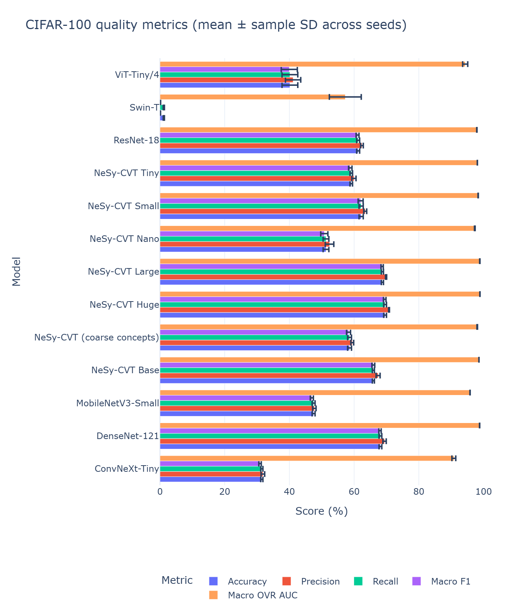
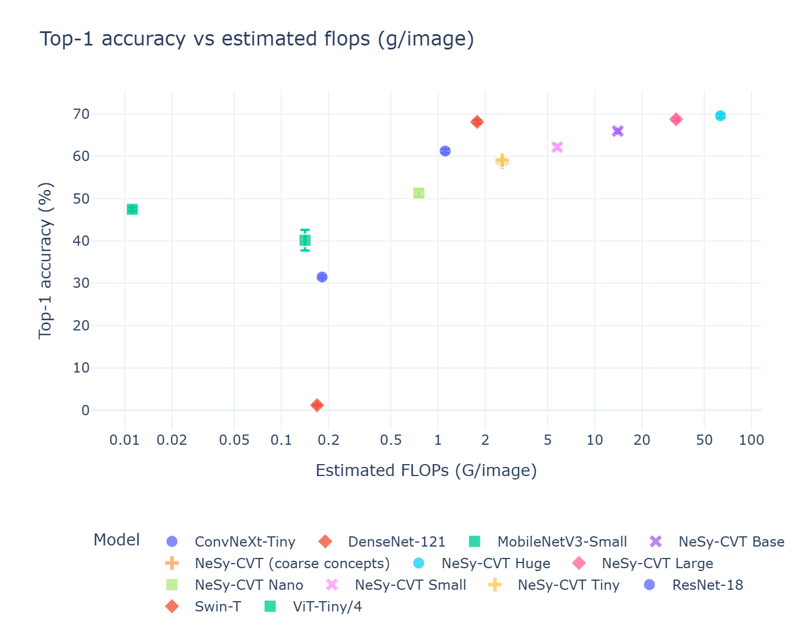
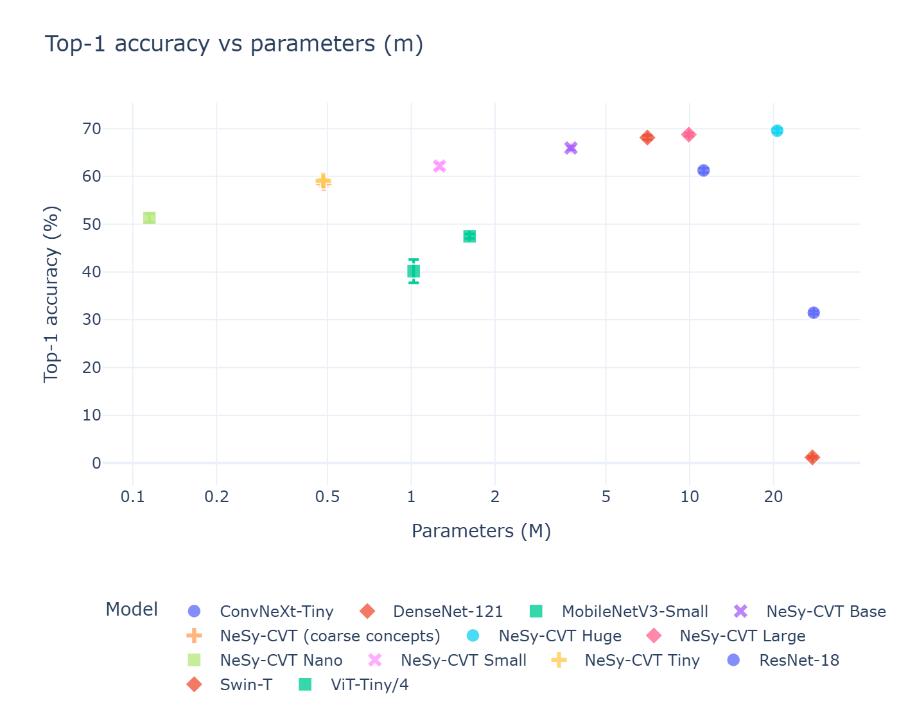
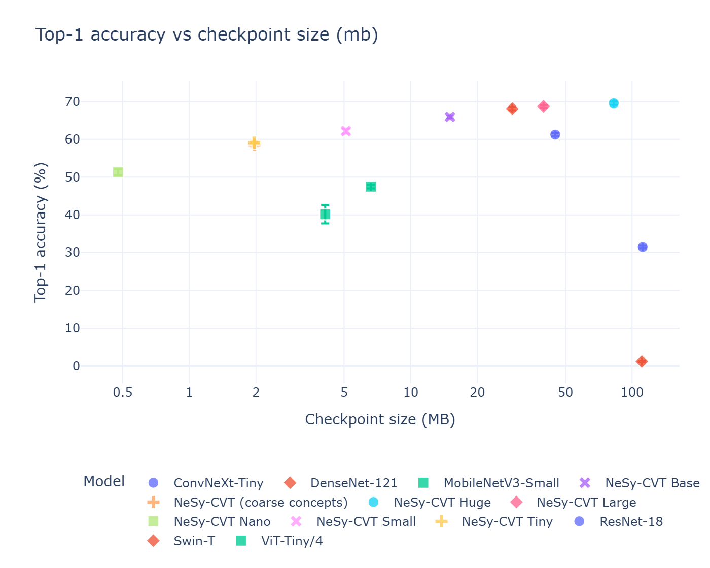
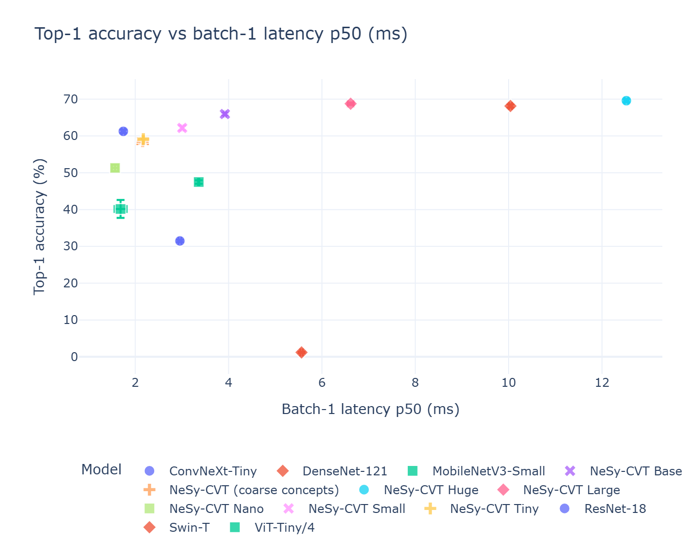
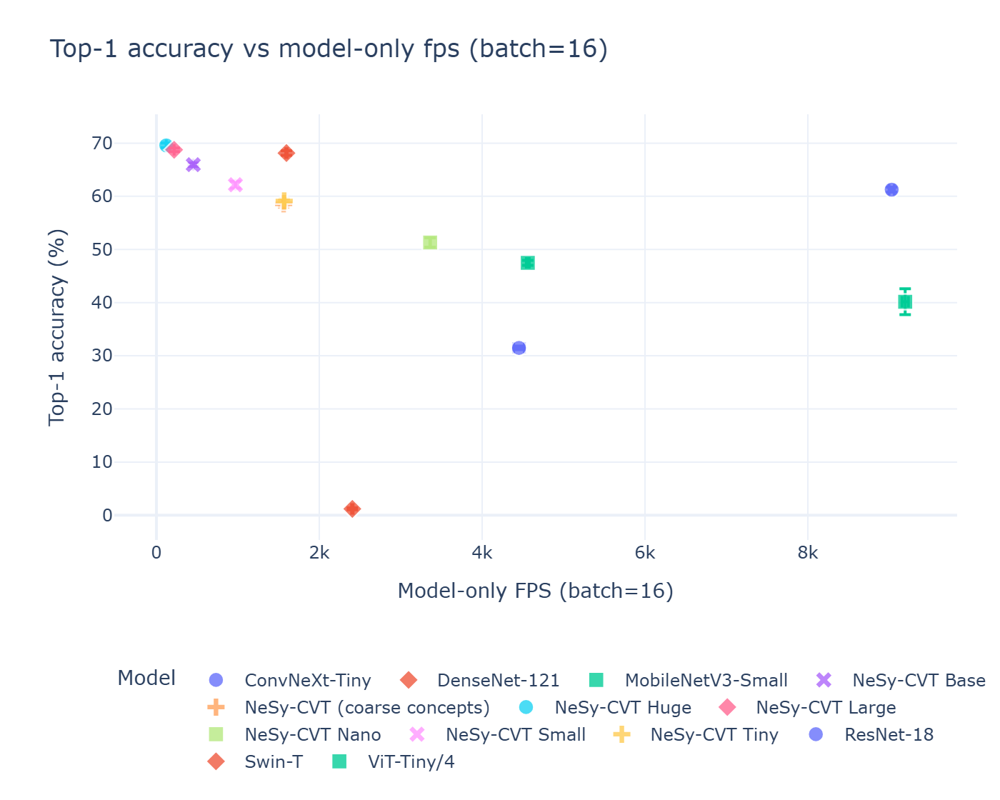
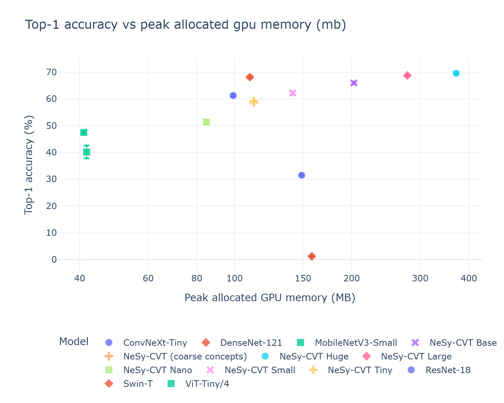

# CIFAR-100 comparison artifacts

This folder contains the seed-aggregated 13-model comparison, its source JSON, a self-contained Plotly Express dashboard, individual interactive HTML figures, and high-resolution PNG copies.

## Figures

| Figure | Interactive HTML | Static PNG |
|---|---|---|
| Accuracy, precision, recall, F1, AUC | [quality_metrics.html](quality_metrics.html) |  |
| Accuracy vs estimated FLOPs | [flops.html](flops.html) |  |
| Accuracy vs parameter count | [parameters.html](parameters.html) |  |
| Accuracy vs checkpoint size | [size.html](size.html) |  |
| Accuracy vs batch-1 latency | [latency.html](latency.html) |  |
| Accuracy vs batched FPS | [fps.html](fps.html) |  |
| Accuracy vs peak allocated GPU memory | [memory.html](memory.html) |  |

Open [the combined interactive dashboard](benchmark_dashboard.html) in a browser to explore all figures. Hover in the HTML plots for values; legends can show or hide series. PNG figures are static and show error bars for sample standard deviation over the three seeds.

## Tables and source data

- [Full comparative table (Markdown)](comparison_table.md)
- [Full comparative table (CSV)](comparison_table.csv)
- [Detailed source report (JSON)](cifar100-taxonomy-detailed.json)
- [Metric definitions, protocol, and caveats](../../benchmarking.md)

The official CIFAR-100 test set had prior exploratory exposure in this project. Treat these metrics as exploratory matched comparisons, not confirmatory results from an untouched test set. FLOPs are analytical estimates; inference speed and memory measurements are specific to the recorded RTX 5070 setup.
