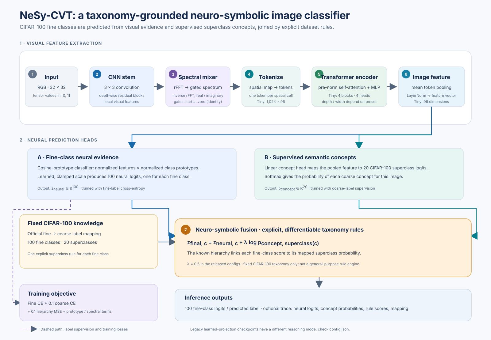

# Working Manuscript: NeSy-CVT

> **Research status:** This is a working manuscript, not a submission-ready paper. The current CIFAR-100 results are exploratory matched comparisons. The project's official CIFAR-100 test set was inspected in earlier runs, and some reference-model outcomes need diagnosis. This draft does not claim state-of-the-art performance. A SOTA result remains a research target that must be established by the protocol in [`paper_experiment_plan.md`](paper_experiment_plan.md).

## Provisional title

**Taxonomy-Conditioned NeSy-CVT: Combining Convolution, Spectral Gating, and Explicit Coarse-Label Rules for CIFAR-100 Classification**

This title describes the implemented model and task. It does not claim novelty, interpretability, or performance superiority.

## Authors and affiliations

`[Add the verified author list, order, affiliations, corresponding author, ORCID identifiers, funding, and acknowledgments.]`

## Abstract

Fine-grained image classification can provide models with known relationships between labels, yet many classifiers predict fine categories without using this hierarchy. We study NeSy-CVT, an image-classification model that combines a convolutional feature stem, a per-channel complex spectral gate, Transformer blocks, a cosine-prototype classifier, and a supervised coarse-category head. For CIFAR-100, a fixed mapping from 100 fine labels to 20 official superclasses adjusts fine-class scores using the predicted superclass probabilities and adds a hierarchy-consistency objective. We evaluate six NeSy-CVT size presets, six CNN or Transformer references, and one legacy coarse-concept configuration under a shared scratch-training recipe on a fixed stratified 45,000/5,000 training/validation split, using three seeds and the same 10,000 official test images. In this exploratory roster, NeSy-CVT Huge reaches 69.58 ± 0.44% top-1 accuracy, while DenseNet-121 reaches 68.13 ± 0.43%. NeSy-CVT Huge uses 20.63 million parameters and an estimated 63.50 billion FLOPs per image, compared with 7.05 million parameters and 1.777 billion estimated FLOPs for DenseNet-121. These measurements indicate an accuracy-compute trade-off within the evaluated roster, not overall superiority. The test split had been inspected during earlier project runs, and the present comparison does not establish a state-of-the-art result. Further baseline validation, component ablations, stronger validation-tuned comparisons, and evaluation on an independent hierarchical dataset are needed.

**Keywords:** image classification; hierarchical classification; vision Transformer; Fourier features; concept supervision; neuro-symbolic learning; CIFAR-100

## 1. Introduction

Image classifiers commonly return one of many fine-grained labels, even when the label set has an available hierarchy. CIFAR-100 provides 100 fine labels grouped into 20 coarse categories (Krizhevsky, 2009), giving a small-scale setting in which both fine-label performance and consistency with a known hierarchy can be measured. A hierarchy can be used as a supervised concept target or as a prior over fine-label scores. The benefit of doing so is an empirical question: additional structure can improve class decisions, leave them unchanged, or introduce errors if its predictions or assumptions are wrong.

This study examines NeSy-CVT, a model family with a convolutional stem, depthwise residual processing, a learned complex-valued spectral gate, self-attention, and cosine-prototype classification. A parallel head predicts the CIFAR-100 coarse category. A fixed fine-to-coarse map then contributes a coarse-category score to each fine-class logit. The mapping is inspectable and supplied by the dataset; the learned components remain the image encoder, concept head, and class prototypes. The method therefore represents a narrowly scoped integration of neural classification and a fixed symbolic taxonomy, rather than a general-purpose rule learner.

The study asks whether this taxonomy path improves fine-class results over a matched encoder, how it affects coarse-label agreement and consistency, and what accuracy/resource trade-offs occur across model sizes. This framing builds on prior convolutional vision Transformers, spectral vision models, concept-based classifiers, and explicit neuro-symbolic vision methods (Wu et al., 2021; Patro and Agneeswaran, 2023; Hong et al., 2024; Zarar et al., 2026). Those works motivate comparisons but do not establish that the current implementation is novel or superior.

The current repository contains a 13-configuration, three-seed CIFAR-100 comparison with accuracy, macro-averaged metrics, calibration measures, parameter count, estimated FLOPs, model size, latency, throughput, training time, GPU memory, and interactive/static figures. The test split was previously inspected in exploratory runs, so the results below are not a pristine confirmatory evaluation. Further, the current experiment uses one fixed 50-epoch recipe; it is controlled across the listed roster but not individually optimized for each architecture. We therefore present these numbers as exploratory and define a validation-tuned study as the next step.

### Contributions under investigation

This manuscript makes no priority or SOTA claim. Its present contributions are an implementation and an exploratory analysis. The hypotheses to test in a stronger study are:

1. A CIFAR-100 coarse-label head and fixed fine-to-coarse score adjustment may improve hierarchical predictions over a matched neural-only classifier.
2. The benefit, if any, may vary with model capacity and resource use.
3. The observed effect may be attributable to concept supervision, rule fusion, consistency regularization, or interactions among them; controlled ablations are needed to identify which.

## 2. Related work

### 2.1 Convolutional and Transformer image models

Convolutional vision Transformers combine convolutional projections or local feature extraction with attention (Wu et al., 2021). Vision Transformer (ViT) processes image patches as tokens; its original small-dataset results use pretraining and transfer, which differs from training a compact model from scratch on 32×32 images (Dosovitskiy et al., 2021). Swin Transformer restricts attention to shifted local windows (Liu et al., 2021). CNN references in this study include residual connections (He et al., 2016), dense feature reuse (Huang et al., 2017), MobileNetV3 (Howard et al., 2019), ConvNeXt (Liu et al., 2022), and wide residual networks (Zagoruyko and Komodakis, 2016). A paper comparison must specify whether each reference is scratch-trained or pretrained and must separate reproduced runs from literature values.

### 2.2 Spectral and Fourier methods

Fourier-domain methods have been studied for image classification and vision architectures. Scattering Vision Transformer, for example, explicitly develops spectral mixing within a Transformer design (Patro and Agneeswaran, 2023). NeSy-CVT's current operation is narrower: it applies one learned complex scalar per channel, shared across the two-dimensional Fourier coefficients, before the inverse transform. It does not learn a distinct weight for every frequency location. Component ablations and comparisons with appropriate spectral baselines are needed to determine whether this gate contributes useful information.

### 2.3 Concepts, taxonomies, and neuro-symbolic vision

Concept-Centric Transformers learn object-centered semantic concepts and coordinate them through a shared workspace (Hong et al., 2024). NeuroRule studies differentiable rule induction for scene-graph generation (Zarar et al., 2026). These approaches differ from the present fixed CIFAR-100 fine-to-coarse map. NeSy-CVT predicts 20 dataset-defined superclasses and uses the known mapping to modify class scores; it does not discover rules or ground concepts in human annotations. A full related-work and novelty review remains necessary before submission.

## 3. Method

### 3.1 Architecture



**Figure 1.** Implemented CIFAR-100 taxonomy path. The spectral component should be read as a per-channel complex spectral gate. The fixed mapping is the CIFAR-100 fine-to-coarse table; it is not a general knowledge base. A high-resolution raster version is available at [`figures/architecture_overview.png`](figures/architecture_overview.png).

For a 32×32 RGB input, the stem applies a 3×3 convolution, batch normalization, and GELU, followed by depthwise residual blocks. The Tiny configuration has embedding width 96, two depthwise residual blocks, and four Transformer blocks with four attention heads and a 4× MLP expansion. Tokens are obtained by flattening the spatial feature map, then mean-pooled and normalized. The other presets change embedding width, depth, and number of attention heads according to `src/nesy_cvt/model_factory.py`; exact values and parameter counts should be listed in the final supplement.

The spectral gate computes an orthonormal 2-D real FFT, multiplies each channel's spectrum by a bounded complex gain, and applies the inverse transform:

```text
X = rFFT2(x, norm="ortho")
G_c = tanh(A_c) + i tanh(B_c)
y = irFFT2(X * (1 + G_c), norm="ortho")
```

Here `A_c` and `B_c` are learned scalar parameters broadcast over the spatial frequency coordinates for channel `c`. The new configuration returns `y`, making the operation an identity when the gates are zero. Historical checkpoints without an explicit spectral mode use a legacy residual that adds `x` to the inverse-transformed result; those checkpoints are a separate model revision and are not pooled with the taxonomy-size results.

The pooled feature vector is passed to a cosine-prototype classifier. A parallel linear head predicts the 20 coarse categories. Let `z_j` be the neural fine-class logit for class `j`, let `a_k` be the coarse-concept logit for category `k`, and let `g(j)` map fine class `j` to its known superclass. The taxonomy-mode score is

```text
q_k = softmax(a)_k
z'_j = z_j + alpha * log(q_{g(j)}),   alpha = 0.5
```

The implementation exposes the neural scores, concept probabilities, per-class rule scores, and mapping in an optional reasoning trace. This provides an inspectable computation path; it does not, by itself, demonstrate human interpretability.

### 3.2 Training objective

For taxonomy mode, the training loss is

```text
L = CE(z', y)
  + 0.10 CE(a, g(y))
  + 0.10 MSE(softmax(a), aggregate_g(softmax(z)))
  + 0.05 [1 - cosine(h, p_y)]
  + 0.01 |mean(|X'|) - mean(|X|)|
```

`y` is the fine label; `g(y)` is its CIFAR-100 superclass; `h` is the pooled image feature; and `p_y` is the labeled class prototype. `aggregate_g` sums neural fine-class probabilities into their 20 coarse categories. The consistency term compares this aggregation with the concept-head probabilities. `X` and `X'` are the channel spectra before and after gating. The final term penalizes a change in mean spectral magnitude; it is not a general smoothness guarantee. The legacy learned-projection variant has a different objective and is reported separately.

### 3.3 Scope of the symbolic component

The symbolic information in this implementation is the fixed CIFAR-100 fine-to-coarse relation. The model does not infer this relation from images, learn new rules, or accept an arbitrary external rule set. Its concept names are the dataset's 20 coarse categories. Results on this task cannot establish that the model reasons correctly on other taxonomies, explains individual decisions to users, or generalizes to other datasets.

## 4. Experimental setup

### 4.1 Data, split, and checkpoint selection

The official CIFAR-100 training set contains 50,000 examples. The comparison uses a fixed stratified split with 45,000 training and 5,000 validation examples, 50 validation images per fine class, and split seed 1729. The same split is reused across model runs. Checkpoints are selected by validation top-1. The reported comparison evaluates the same official 10,000 test examples for all models. Earlier project runs inspected that official test set; therefore the current test scores are exploratory and must not be described as results from an untouched holdout.

Training augmentation is `Resize(32)`, the CIFAR-10 AutoAugment policy (Cubuk et al., 2019), and `ToTensor`. Evaluation uses `Resize(32)` and `ToTensor`. No ImageNet pretraining is used for the recorded comparison. State all deviations, including architecture-specific input adaptations, when the reruns are reported.

### 4.2 Training recipe and hardware

The recorded fixed recipe uses 50 epochs, batch size 16, AdamW at learning rate 0.0003, float32, gradient clipping at 1.0, deterministic cuDNN settings, and no learning-rate scheduler. Runs were performed on an NVIDIA GeForce RTX 5070 under Windows, Python 3.12.6, PyTorch 2.13.0+cu132, and CUDA runtime 13.2. The same numerical recipe across architectures provides a controlled fixed-recipe comparison, but it does not ensure equal convergence or equal hyperparameter quality. In particular, reference architectures require learning-curve and input-path sanity checks before they are used in a superiority claim.

### 4.3 Metrics

Classification metrics include top-1 and top-5 accuracy, unweighted macro precision, recall, and F1 over the 100 fine classes, macro one-vs-rest ROC AUC, 15-bin expected calibration error, and negative log-likelihood. Taxonomy-mode metrics also include coarse top-1, fine/coarse agreement, and hierarchy-consistency MAE.

Resource metrics include parameter count, checkpoint size, analytical FLOPs per image, batch-1 device latency, model-only throughput at batch size 16, evaluation-pipeline throughput, training time, and peak allocated GPU memory. FLOPs count selected convolution, linear, attention, classifier, and approximate 2-D FFT work under the documented convention; normalization, activations, softmax, pooling, and much elementwise/backend work are excluded. Thus FLOPs are estimates, not exact device instruction counts. Batch-1 latency is measured with one image already on the GPU and excludes data loading and host-to-device transfer; batched FPS is a different throughput measure. The two must not be conflated.

### 4.4 Model lineup

The exploratory roster comprises six taxonomy-mode NeSy-CVT presets (Nano, Tiny, Small, Base, Large, Huge), four CNN references (CIFAR-stem ResNet-18, MobileNetV3-Small, CIFAR-stem DenseNet-121, ConvNeXt-Tiny), two Transformer references (ViT-Tiny/4 and Swin-Tiny), and a learned coarse-concept NeSy-CVT revision. The detailed table and run-level JSON are in [`benchmark/cifar100-taxonomy-family/`](benchmark/cifar100-taxonomy-family/). A scratch-trained Wide-ResNet-28-10 reference has been added to the next-study runner; no multi-seed result is available yet.

This is a bounded roster, not an exhaustive CNN/Transformer comparison. The exceptionally weak Swin-Tiny result and low ConvNeXt-Tiny result require training-path investigation and reruns before either can support a ranking claim. A stronger SOTA-targeted study should add CIFAR-specific competitive references, such as Wide-ResNet-28-10 or PreAct-ResNet, use validation-tuned settings with an equal search budget, and report pretrained and scratch-trained tracks separately. The planned lineup and acceptance checks are specified in [`paper_experiment_plan.md`](paper_experiment_plan.md).

## 5. Exploratory results

### 5.1 Fine-class quality and model size

Across three seeds (42, 43, and 44), NeSy-CVT Huge reached 69.58 ± 0.44% top-1 and 90.77 ± 0.06% top-5. DenseNet-121 reached 68.13 ± 0.43% top-1 and 89.89 ± 0.26% top-5. The difference in this roster is 1.45 percentage points in top-1, but it is not sufficient evidence of an overall or SOTA advantage: NeSy-CVT Huge has 20.63M parameters versus 7.05M for DenseNet-121, and 63.500 estimated GFLOPs/image versus 1.777G. Mean training time was 19.06 hours per seed for Huge and 1.68 hours for DenseNet-121.

At smaller sizes, NeSy-CVT Tiny reached 59.12 ± 0.39% top-1 with 0.48M parameters, while ResNet-18 reached 61.25 ± 0.46% with 11.22M parameters. NeSy-CVT Nano reached 51.31 ± 0.89% with 0.11M parameters, while MobileNetV3-Small reached 47.47 ± 0.46% with 1.62M parameters. Nano's estimated compute was 0.755G FLOPs/image compared with 0.011G for MobileNetV3-Small, so its smaller parameter count and checkpoint do not imply lower computation or faster execution.

Among the six NeSy-CVT presets, top-1 accuracy rises from Nano (51.31 ± 0.89%) through Small (62.17 ± 0.65%), Base (65.95 ± 0.32%), Large (68.75 ± 0.33%), and Huge (69.58 ± 0.44%); Tiny reached 59.12 ± 0.39%. The larger models also incur increased compute and training time. These results motivate an accuracy-resource analysis rather than a single-metric ranking.

### 5.2 Coarse-label and calibration measures

For NeSy-CVT Tiny, the recorded mean coarse top-1 was 68.90 ± 0.44%, fine/coarse agreement was 81.31 ± 0.59%, and hierarchy-consistency MAE was 0.0295 ± 0.0002. For NeSy-CVT Huge, corresponding values were 79.68 ± 0.29%, 90.34 ± 0.40%, and 0.0211 ± 0.0007. These are descriptive measures from the same previously inspected test split; they do not show that rule fusion caused higher fine accuracy. The rule and consistency ablations are needed for that conclusion.

### 5.3 Efficiency trade-offs

The complete 13-model table reports macro precision, recall, F1, macro AUC, ECE, NLL, parameters, analytical FLOPs, checkpoint size, latency, FPS, GPU memory, and training time. Interactive Plotly Express dashboards and corresponding PNGs are provided in the benchmark-artifact directory. The efficiency results are hardware- and protocol-specific. For example, Huge's batch-16 model throughput was 121 images/s, versus 1,597 images/s for DenseNet-121. These figures should be reproduced on the target hardware and reported with their batch and timing definitions.

### 5.4 Baseline diagnostics and test exposure

The current Swin-Tiny top-1 score is 1.19 ± 0.19%, close to random performance for 100 classes; ConvNeXt-Tiny reached 31.48 ± 0.34%. These rows are a warning that the shared 50-epoch training recipe or model adaptation may not be adequate for every baseline. They should remain visible in the exploratory artifact, but a publishable comparison needs validated data/model paths and successful training curves before interpreting them.

All numerical test results in this section are exploratory because the official test split was inspected in previous project runs. Although the split was excluded from these benchmark runs' training and checkpoint selection, prior project-level access means it is not a pristine holdout for this study. Do not use these numbers for a confirmatory SOTA or generalization claim.

## 6. Planned experiments before a SOTA claim

The next study should first validate model and data paths, then evaluate a compact, high-performing baseline lineup under two clearly separated tracks: a shared fixed recipe and an equal-budget validation-tuned recipe. The runner now includes a separate CIFAR-100 v2 transform path with crop, flip, AutoAugment, and dataset normalization; selectable AdamW/SGD; cosine learning-rate decay; and Wide-ResNet-28-10. A one-epoch validation-only preflight checks these paths; its scores are not research results. The earlier 50-epoch schedule had no learning-rate decay. The primary NeSy-CVT size should be selected from validation/resource trade-offs, and the main comparison and key ablations should be repeated over at least five seeds where feasible.

The planned ablations independently vary rule fusion, hierarchy consistency, coarse-label supervision, the spectral gate, attention, and classifier type. The current no-concept-head ablation configuration must be made valid and described as removing the coupled concept/rule branch if both are removed. An independent dataset with its own documented hierarchy is needed before making claims about transfer or broader generalization. A SOTA claim should be added only if the final locked result is reproducible and stronger than current directly comparable work under the explicitly stated benchmark regime.

## 7. Limitations

1. **Prior test access:** CIFAR-100 official test results were inspected earlier in project development. Current comparisons are exploratory, not pristine confirmatory results.
2. **Fixed training recipe:** Equal settings do not imply equal convergence. The 50-epoch AdamW schedule has no decay and was not tuned separately for each architecture.
3. **Baseline health:** Very weak Transformer results need diagnosis before comparative claims can be made.
4. **One dataset and resolution:** CIFAR-100 is a 32×32 classification benchmark and cannot establish broad computer-vision performance.
5. **Narrow symbolic prior:** The fixed rules encode only the supplied CIFAR-100 taxonomy. This does not demonstrate general-purpose logical reasoning.
6. **Interpretability:** Exposing concepts and rule scores is not a user study or proof that explanations are faithful and useful.
7. **Efficiency estimates:** FLOPs are approximate and hardware timing is specific to one RTX 5070 system and the documented settings.
8. **Novelty:** The paper needs a complete literature search and ablation evidence to establish a distinct contribution beyond combining known model components.

## 8. Reproducibility and artifact availability

The repository includes the benchmark protocol, model implementation, architecture diagram, per-seed report, CSV summary, Plotly Express HTML, and PNG figures. The final paper should record the exact Git revision, Python/PyTorch/CUDA/driver versions, GPU/CPU, seeds, split and dataset hashes, training configuration, checkpoints or hashes, and all per-run results. The corresponding artifacts are under [`benchmark/cifar100-taxonomy-family/`](benchmark/cifar100-taxonomy-family/), and implementation details are in [`architecture.md`](architecture.md), [`mathematics.md`](mathematics.md), and [`benchmarking.md`](benchmarking.md).

## 9. Conclusion (provisional)

This work implements a CIFAR-100 classifier that combines learned visual features with supervised predictions of the dataset's coarse labels and a fixed fine-to-coarse score adjustment. Exploratory results show a measurable accuracy-resource trade-off across the current model family and reference roster. The results do not yet establish that taxonomy reasoning improves fine accuracy, that the model is SOTA, or that the method generalizes beyond CIFAR-100. Those questions require validated baselines, controlled ablations, a stronger validation-tuned comparison, and additional evaluation before the manuscript can support broader claims.

## 10. Submission details still required

- Complete related-work and novelty search, with a dated comparison table of directly comparable papers.
- Resolve author list, affiliations, ORCIDs, corresponding author, funding, acknowledgments, and conflicts.
- Select the exact journal or conference and format to its current requirements.
- Verify venue ranking in its stated system, year, and subject category; a Q1 or A* outcome cannot be guaranteed by the manuscript.
- Add the final validated experiments, exact plots/tables, data and code statements, and reproducibility artifacts.
- Follow the target venue's policies on preprints, anonymous review, dataset licensing, code, and AI-assisted writing.
